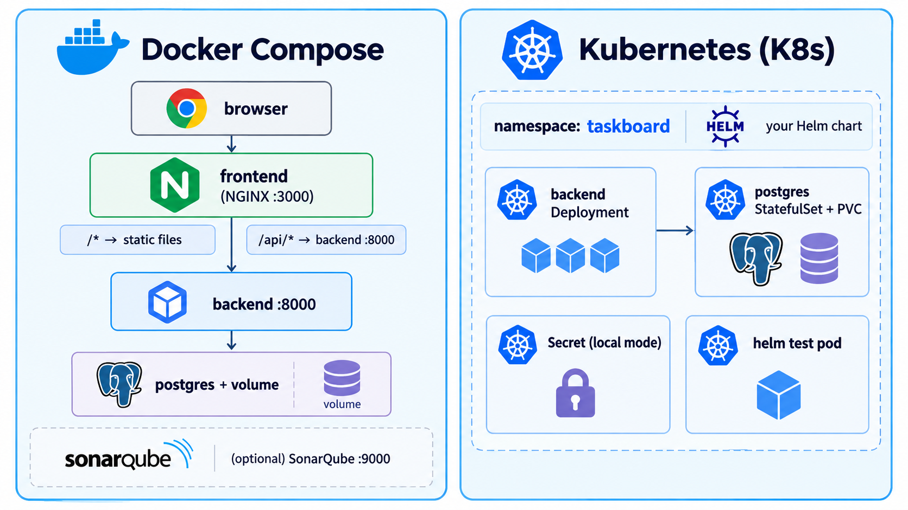
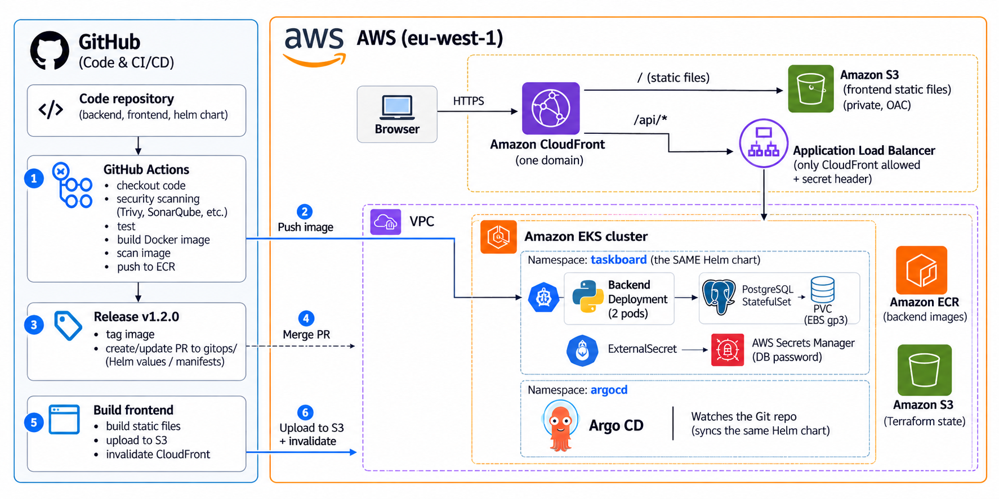
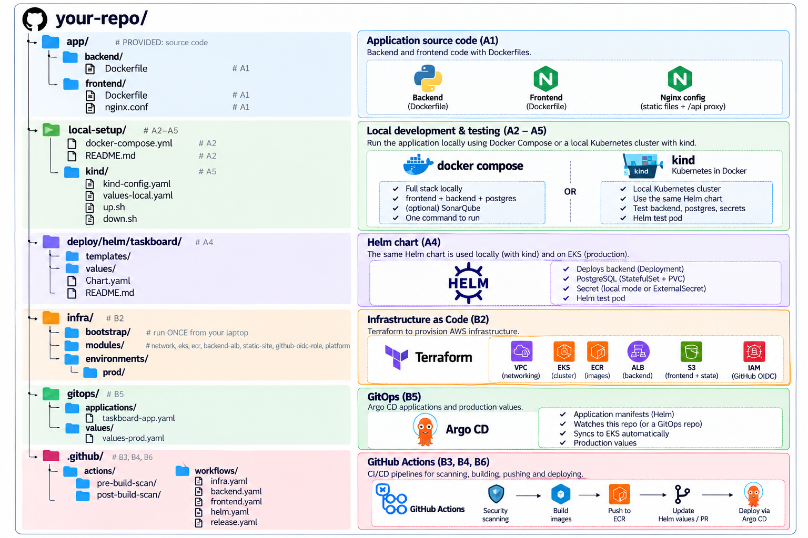

# Final Project: TaskBoard, From Laptop to Production on AWS

## 1. Your Mission
You are the DevOps engineer of a small product team. The developers have written **TaskBoard**, a task manager with a **Next.js** frontend, a **Python FastAPI** backend and a **PostgreSQL** database. They give you **only the source code**. Your job happens in two parts:

| Part | Goal | Where |
|------|------|-------|
| **A. Local Setup** | Containerise the app, run the full stack with **Docker Compose**, scan it, package it as a **Helm chart** and run it on a local **Kubernetes** cluster (minikube) | Your laptop (free) |
| **B. Deploy to AWS EKS** | Create the infrastructure with **Terraform**, automate everything with **GitHub Actions** (with security scans), and deliver with **Argo CD** (GitOps) | AWS (costs money) |

> **Finish Part A before you start Part B.** Everything you deploy to AWS (images, chart, scans) is built and tested locally first. Debugging on your laptop is free and fast; debugging on EKS is slow and costs money.

You will use everything from the course: Git workflows, GitHub Actions, Docker, Kubernetes, Helm, Terraform and AWS.

## 2. The Application (Provided)
You receive the source code in `app/`. You should not need to change it, apart from fixing anything the scanners find.

| Folder | Technology | What you need to know |
|--------|-----------|-----------------------|
| `app/backend` | Python 3.13, FastAPI, SQLAlchemy | Dependencies in `requirements.txt` (tests: `requirements-dev.txt`). Start command: `uvicorn taskboard.main:app --host 0.0.0.0 --port 8000`. Configured with environment variables (below) |
| `app/frontend` | Next.js 16 (React, TypeScript) | `npm ci && npm run build` produces a **static website** in `out/`. The browser calls the API on the **same domain**, under `/api` |
| Database | PostgreSQL 17 | One table `tasks`, created by the backend at startup |

Backend environment variables:
| Variable | Example | Purpose |
|----------|---------|---------|
| `DB_HOST`, `DB_PORT`, `DB_NAME`, `DB_USER`, `DB_PASSWORD` | `db`, `5432`, `taskboard`, `taskboard`, `***` | Database connection |
| `APP_VERSION` | `v1.0.0` | Shown by `/api/health` and in the UI footer |
| `ENVIRONMENT` | `local`, `production` | Shown by `/api/health` |
| `CORS_ORIGINS` | `http://localhost:3000` | Only needed when the frontend runs on another origin (`npm run dev`) |

Backend endpoints:
| Method & path | Purpose |
|---------------|---------|
| `GET /api/health` | **Liveness**: the process is up (also returns the version) |
| `GET /api/health/ready` | **Readiness**: the database answers (HTTP 503 otherwise) |
| `GET/POST /api/tasks`, `PATCH/DELETE /api/tasks/{id}` | The task API |
| `GET /api/docs` | Interactive API documentation |
| `GET /metrics` | Prometheus metrics (for the monitoring part of the diploma) |

## 3. The Big Picture

### Part A: on your laptop


Locally, **nginx plays the role of CloudFront**: it serves the static frontend and forwards `/api/*` to the backend. So the frontend behaves exactly as it will in AWS.

### Part B: on AWS


What changes between local and AWS is **only configuration** (Helm values): image location, storage class, where the password comes from, and how traffic reaches the pods. The images and the chart are the same.

Why the AWS side is built this way:
- **One domain for everything:** CloudFront serves the static files **and** forwards `/api/*` to the backend, so there's no CORS and no mixed HTTP/HTTPS content.
- **The ALB is not open to the internet:** its security group only accepts CloudFront's IP ranges, and the listener only forwards requests carrying a secret header that only your CloudFront distribution sends.
- **Terraform owns the ALB; Kubernetes owns the pods:** a `TargetGroupBinding` (AWS Load Balancer Controller) registers the backend pods in the target group that Terraform created.
- **No passwords in Git:** the database password is generated by Terraform, stored in **AWS Secrets Manager** and copied into the cluster by the **External Secrets Operator**.
- **No AWS keys in GitHub:** workflows log in to AWS with **OpenID Connect** roles.

## 4. What You Will Create



---

# PART A: Local Setup

### Phase A0: Prerequisites (Part A)
- [ ] Tools: `git`, `docker` (Docker Desktop or Engine), `kubectl`, `helm`, `minikube`.
- [ ] A **public** GitHub repository `taskboard` containing the provided `app/` folder. Work with branches and Pull Requests from the start.

### Phase A1: Containerise the Application
**Backend image** (`app/backend/Dockerfile`):
- [ ] Based on an official, **slim**, **pinned** Python image (e.g. `python:3.13-slim`).
- [ ] Copy `requirements.txt` and install the dependencies **before** copying the code (layer caching).
- [ ] The runtime image contains **no package manager** you don't need (hint: uninstall `pip` after installing the dependencies).
- [ ] Runs as a **non-root user with a numeric UID** (e.g. `USER 10001`), so Kubernetes can check `runAsNonRoot`.
- [ ] `APP_VERSION` can be set at build time (`ARG` → `ENV`).
- [ ] A `.dockerignore` keeps tests, caches and virtual environments out of the image.

**Frontend image** (`app/frontend/Dockerfile`), for **local use only** (in AWS the static files go to S3):
- [ ] **Multi-stage build:** stage 1 (`node:22-alpine`) runs `npm ci` and `npm run build`; stage 2 (an **unprivileged nginx** image) serves `out/`.
- [ ] nginx forwards `/api/` to the backend; the backend address comes from an environment variable (e.g. `BACKEND_URL`, using nginx's `templates/` + `envsubst` feature).
- [ ] Runs as non-root and listens on port 8080.

✅ **Done when:** both images build, and `docker run` of the backend answers `/api/health` (tip: `-e DATABASE_URL=sqlite+pysqlite:///:memory:` runs it without PostgreSQL).

### Phase A2: Docker Compose
Create `local-setup/docker-compose.yml` with:
| Service | Requirements |
|---------|-------------|
| `db` | `postgres:17-alpine`, a **named volume** for the data, a **healthcheck** with `pg_isready` |
| `backend` | Built from `app/backend`, database settings as environment variables, port `8000`, starts only when `db` is **healthy**, has its own healthcheck on `/api/health/ready` |
| `frontend` | Built from `app/frontend`, `BACKEND_URL=http://backend:8000`, port `3000 → 8080`, starts when `backend` is healthy |
| `sonarqube` | `sonarqube:community` on port `9000`, only started with a **profile** (`docker compose --profile sonar up`) |

Write `local-setup/README.md` explaining how to start, use and stop everything.

✅ **Done when:** `docker compose up --build` starts everything healthy, you can add / complete / delete tasks at http://localhost:3000, and the tasks survive `docker compose restart backend` (and even `docker compose down` + `up`, **without** `-v`).

### Phase A3: Scan Locally (Shift Left)
Run every scanner of the future pipelines **on your laptop first**, with their pinned Docker images:
| Scanner | Command (from the repo root) | Finds |
|---------|------------------------------|-------|
| Gitleaks | `docker run --rm -v "$PWD:/src" ghcr.io/gitleaks/gitleaks:v8.30.1 dir /src --redact` | Secrets |
| TruffleHog | `docker run --rm -v "$PWD:/src" trufflesecurity/trufflehog:3.99.2 filesystem /src` | Secrets |
| Trivy (files) | `docker run --rm -v "$PWD:/src" aquasec/trivy:0.75.0 fs /src --scanners vuln,secret,misconfig --severity HIGH,CRITICAL` | Vulnerable dependencies, secrets, Dockerfile/Kubernetes/Terraform misconfigurations |
| Trivy (image) | `docker run --rm -v /var/run/docker.sock:/var/run/docker.sock aquasec/trivy:0.75.0 image <your-backend-image> --severity HIGH,CRITICAL --ignore-unfixed` | Vulnerable OS packages and libraries in the image |
| SonarQube | `docker compose --profile sonar up -d`, create a project + token at http://localhost:9000, then run `sonarsource/sonar-scanner-cli` on `app/backend` | Bugs, code smells, coverage, quality gate |

Fix what they find. Tip: an image built from an **old cached base image** can show CRITICAL vulnerabilities; build with `docker build --pull`.

✅ **Done when:** no HIGH/CRITICAL findings in your images and files, and the backend passes the SonarQube quality gate.

### Phase A4: The Helm Chart
Create `deploy/helm/taskboard`, which deploys the backend and the database (and, **locally only**, the frontend) **into one namespace**. This chart is used **locally now and on EKS later**: design its values for both.

| Object | Requirements |
|--------|-------------|
| Backend `Deployment` | Replicas from values, `readinessProbe` on `/api/health/ready`, `livenessProbe` on `/api/health`, CPU/memory requests and memory limit, **non-root**, **read-only root filesystem**, all capabilities dropped. An **init container** waits until PostgreSQL accepts connections |
| Backend `Service` | `ClusterIP`, port 8000 |
| PostgreSQL `StatefulSet` | 1 replica, `postgres:17-alpine`, **`volumeClaimTemplates`** (size + StorageClass from values), `pg_isready` probes, **non-root**, **read-only root filesystem** (give PostgreSQL writable `emptyDir` volumes where it needs them) |
| Headless `Service` | `clusterIP: None` for the StatefulSet |
| Credentials | **Two modes** selected by values: a plain `Secret` (local only) **or** an `ExternalSecret` + `SecretStore` reading AWS Secrets Manager (for Part B) |
| `TargetGroupBinding` | Disabled by default; when enabled (Part B), registers the backend Service in an ALB target group (`targetType: ip`) |
| Frontend `Deployment` + `Service` | **Optional, local only** (`frontend.enabled`): your nginx frontend image, with `BACKEND_URL` pointing to the backend **Service** so `/api/*` reaches the backend inside the cluster. Non-root, read-only root filesystem (writable `emptyDir` for `/tmp` and `/etc/nginx/conf.d`). Disabled on EKS, where S3 + CloudFront serve the frontend |
| `helm test` | A test pod that creates and reads a task through the API, and (when the frontend is enabled) loads the page and calls `/api` **through the frontend** |

Keep one values file per environment **next to the chart**:
- `values-local.yaml`: minikube (plain Secret, default StorageClass, image `pullPolicy: Never`, no ALB);
- `values-prod.yaml`: EKS (ECR image, ExternalSecret, TargetGroupBinding). You fill it in Part B.

✅ **Done when:** `helm lint` is clean and `helm template` renders correctly with **both** values files.

### Phase A5: Local Kubernetes with minikube
In `local-setup/minikube/` create:
- `up.sh`: starts a minikube cluster with its own **profile** `taskboard` if needed (`minikube start -p taskboard --cpus 2 --memory 4096`), so other minikube clusters on your laptop are untouched → builds the backend **and frontend** images → `minikube -p taskboard image load` (both) → `helm upgrade --install -f values-local.yaml --wait` → `helm test --logs`;
- `down.sh`: deletes the profile (`minikube delete -p taskboard`).

> Why `image load`? Your image is only on your laptop, not in a registry. `image load` copies it into minikube, and `pullPolicy: Never` in `values-local.yaml` tells Kubernetes not to try downloading it.

Then prove that it really works:
1. **The app:** `kubectl -n taskboard port-forward svc/taskboard-frontend 3000:8080` and open http://localhost:3000. Add tasks in the UI: the frontend pod forwards `/api` to the backend Service, which talks to PostgreSQL.
2. **Persistence:** create tasks, `kubectl -n taskboard delete pod taskboard-postgres-0`, wait for it to come back. The tasks are still there.
3. **Security:** `kubectl exec` into the pods: `id` shows a non-root user, and `touch /usr/x` fails (read-only filesystem).

✅ **Done when:** `./up.sh` ends with a passing `helm test` (API + frontend), and the three checks work.

### Phase A6: Argo CD on minikube (GitOps on Your Laptop)
Until now **you** deployed with `helm upgrade`. With **Argo CD**, the cluster deploys **itself** from Git:

```text
  you: git push  ─►  GitHub repo  ◄── Argo CD (inside the cluster) checks it every ~3 minutes
                     deploy/helm/taskboard/          "Is Git different from what's running?"
                       values-local.yaml  changed!   ─► renders the chart again
                                                     ─► applies ONLY what changed (e.g. the Deployment)
```

Argo CD itself is **just another Helm chart** (`argo/argo-cd`). You tell it what to watch with **one** small file, an `Application`:

```yaml
# gitops/applications/taskboard-local.yaml
apiVersion: argoproj.io/v1alpha1
kind: Application
metadata:
  name: taskboard
  namespace: argocd
spec:
  project: default
  source:
    repoURL: https://github.com/<you>/taskboard.git   # WHICH repo
    targetRevision: main                             # WHICH branch
    path: deploy/helm/taskboard                      # WHICH folder (your chart)
    helm:
      valueFiles: [values-local.yaml]                # WHICH values
  destination:
    server: https://kubernetes.default.svc           # WHERE: this cluster
    namespace: taskboard
  syncPolicy:
    automated:                                       # deploy changes automatically
      prune: true                                    # remove what was removed from Git
      selfHeal: true                                 # undo manual changes (kubectl edit/scale)
    syncOptions: [CreateNamespace=true]
```

Create:
- `gitops/applications/taskboard-local.yaml` (above) and `taskboard-prod.yaml` (same, with `values-prod.yaml`, used in Part B);
- `gitops/install-argocd.sh <application-file>`: `helm upgrade --install argocd argo/argo-cd -n argocd --create-namespace --wait`, then `kubectl apply -f <application-file>`. The **same script** is used on minikube and on EKS;
- an `argocd` mode in `up.sh` (`./up.sh argocd`) that loads the image and runs `install-argocd.sh` instead of `helm install`.

Then see GitOps in action (push your repo to GitHub first, Argo CD reads it from there):
1. `./down.sh && ./up.sh argocd`, then open the UI (`kubectl -n argocd port-forward svc/argocd-server 8080:443`, user `admin`, password in the secret `argocd-initial-admin-secret`).
2. Change `replicas: 1` to `replicas: 2` in `values-local.yaml`, **commit and push**. Within ~3 minutes (or click **Refresh**) Argo CD shows *OutOfSync*, then syncs: a second backend pod appears. **Only the Deployment changed**; PostgreSQL wasn't touched.
3. Run `kubectl -n taskboard scale deploy taskboard-backend --replicas=5`. Argo CD puts it back to 2 (**self-heal**): Git wins.

✅ **Done when:** a `git push` of a values change is deployed by Argo CD without any `helm` or `kubectl apply` command.

### 🏁 Checkpoint A
Before moving to AWS, demo to yourself (or your instructor): Compose stack working, clean scans, chart on minikube with `helm test` passing, data persistence, and a change deployed by Argo CD from a `git push`. **Everything in Part B reuses these pieces.**

---

# PART B: Deploy to AWS EKS

> ⚠️ **Part B costs money.** EKS, the NAT gateway, the ALB and the EC2 nodes cost roughly **5–7 USD per day**. Create a **budget alert** first, and **destroy** the infrastructure when you're not working on it (Phase B8).

### Phase B0: Prerequisites (Part B)
- [ ] An AWS account with an **IAM user/role for yourself** (never use the root user) and a **budget alert** (e.g. 30 USD).
- [ ] `aws` CLI v2 and `terraform` ≥ 1.10 installed.
- [ ] A free **SonarQube Cloud** account (sonarcloud.io) linked to GitHub, with projects `taskboard-backend` and `taskboard-frontend`, and a token.

### Phase B1: Terraform Bootstrap
`infra/bootstrap` is applied **once, from your laptop** (local state). It creates what the pipelines need before they can run Terraform themselves:
- an **S3 bucket** for the Terraform state (versioning + encryption + public access block);
- the **GitHub OIDC provider** (`token.actions.githubusercontent.com`);
- the role `taskboard-github-infra` that the infra workflow assumes, trusted **only** for your repository (`pull_request`, `main`, and the `infrastructure` environment).

```bash
cd infra/bootstrap
cp terraform.tfvars.example terraform.tfvars   # fill it in
terraform init && terraform apply
```

### Phase B2: Terraform Modules & Environment
Write the modules in `infra/modules` and wire them in `infra/environments/prod`:

| Module | Must create |
|--------|-------------|
| `network` | VPC with 2 AZs, public + private subnets, **one** NAT gateway, subnet tags for load balancers |
| `eks` | EKS cluster (private nodes), managed node group (2 × `t3.medium`), add-ons `vpc-cni`, `coredns`, `kube-proxy`, `eks-pod-identity-agent`, `aws-ebs-csi-driver` (with a Pod Identity role, and `defaultStorageClass` enabled so PVCs get **gp3** volumes), cluster-admin access for you |
| `ecr` | Repository with **immutable tags**, scan on push, lifecycle policy |
| `backend-alb` | ALB + **IP** target group (health check `/api/health/ready`), security group allowing **only** the CloudFront managed prefix list, listener that returns **403** unless the secret `X-Origin-Verify` header is present |
| `static-site` | **Private** S3 bucket, CloudFront with **Origin Access Control**, behaviour `/api/*` → ALB (caching **disabled**, all methods), default behaviour → S3 (cached, HTTPS redirect, security headers) |
| `github-oidc-role` | Reusable IAM role assumable by GitHub Actions for a list of `sub` claims |
| `platform` | Helm releases of the add-ons your chart needs: **AWS Load Balancer Controller** (for the TargetGroupBinding) and **External Secrets Operator** (for the ExternalSecret), both with **Pod Identity** |

In the environment, also create: the DB password (`random_password`) stored in **Secrets Manager**, a security group rule **ALB → pods on 8000**, and the role `taskboard-prod-github-deploy` (least privilege: push to **this** ECR repo, write to **this** bucket, invalidate **this** distribution).

Rules:
- Remote state in S3 with **`use_lockfile = true`** (state locking).
- Pin provider and module versions. `terraform fmt` and `terraform validate` must pass.
- **No secrets in `.tf` files or in Git** (`terraform.tfvars` is in `.gitignore`).
- Scan `infra/` with Trivy (as in Phase A3). Accepted risks go into `.trivyignore` (repository root) **with a written reason**.

✅ **Done when:** `terraform validate` passes and `terraform plan` shows the full architecture.

### Phase B3: The Infrastructure Pipeline
Create `.github/workflows/infra.yml`:
- On **pull requests** touching `infra/`: IaC security scan → `fmt -check` → `init` → `validate` → `plan` (summary in the job summary).
- On **push to `main`**: the same, then **`apply`**, protected by the GitHub environment **`infrastructure`** (required reviewer).
- Authenticate with **OIDC** (`aws-actions/configure-aws-credentials`), never with access keys.
- `concurrency` so two Terraform runs never touch the state at the same time.

Merge your Terraform to `main` and approve the apply (it takes ~20 minutes). Then:
1. Copy the outputs into **GitHub → Settings → Secrets and variables → Actions → Variables** (section 5).
2. Fill the `CHANGE_ME` values in `deploy/helm/taskboard/values-prod.yaml` (`ecr_repository_url`, `backend_target_group_arn`), and check that `gitops/applications/taskboard-prod.yaml` points to your repository.
3. Connect `kubectl`: `aws eks update-kubeconfig --region eu-west-1 --name taskboard-prod`.

✅ **Done when:** `kubectl get nodes` shows 2 nodes, and the Load Balancer Controller and External Secrets pods are running.

### Phase B4: CI Pipelines with Security Scans
Turn the scans you ran by hand in Phase A3 into two small **composite actions**, built from the tools' **official GitHub Actions**:

| Action | When | Uses |
|--------|------|------|
| `pre-build-scan` | Before building | `gitleaks/gitleaks-action` + `trufflesecurity/trufflehog` (secrets in the commits), `aquasecurity/trivy-action` with `scan-type: fs` (dependencies, secrets, misconfigurations), `SonarSource/sonarqube-scan-action` (quality gate) |
| `post-build-scan` | After building | `aquasecurity/trivy-action` with `scan-type: image` + an **SBOM**; or `scan-type: fs` on a build output folder (e.g. the frontend's `out/`) |

- Both upload their reports as **artifacts**, even when the scan fails (`if: always()`).
- The secret scanners read the **commits** of the push / pull request: check out with `fetch-depth: 0`.
- Accepted risks go into a `.trivyignore` at the **repository root** (`trivy-action` reads it automatically), each with a written reason.
- Gitleaks is free for repositories owned by a **personal** account; repositories owned by an **organization** need a free `GITLEAKS_LICENSE` key.

> **What is an SBOM?** A *Software Bill of Materials* is the complete **ingredient list** of your image: every OS package and library, with its exact version (here in the standard **CycloneDX** JSON format). Keep it with each release. When a new vulnerability is announced tomorrow (like Log4Shell in 2021), you can answer *"are we affected, and in which version?"* by searching your SBOMs, without rebuilding or rescanning anything. Many companies and governments now require an SBOM for the software they buy or run.

Then the workflows:
| Workflow | Trigger | Steps |
|----------|---------|-------|
| `backend.yml` | PR (backend paths), every push to `main` | lint → tests + coverage → pre-build scan → `docker build --pull` → post-build scan → **push `sha-<commit>` to ECR (main only)** |
| `frontend.yml` | PR / push (frontend paths) | pre-build scan → `npm ci` → lint → typecheck → build → post-build scan of `out/` |
| `helm.yml` | PR / push (`deploy/`, `gitops/`) | `helm lint` (local + prod values) → `helm template` → pre-build scan of the chart |

Rules:
- Pin every action to a version, and **third-party security actions to a full commit SHA** (e.g. `aquasecurity/trivy-action@<40-char-sha> # v0.36.0`). In March 2026, attackers moved almost all `trivy-action` tags to code that stole CI secrets; a SHA can't be moved.
- A **HIGH/CRITICAL** finding fails the pipeline (post-build image gate: **CRITICAL**).
- Protect `main` with a **ruleset**: pull request required, status checks required.

✅ **Done when:** a PR that adds a fake token (e.g. `ghp_` + 36 characters) is **blocked**, and you can download the scan reports from the run.

### Phase B5: GitOps with Argo CD on EKS
Exactly what you did on minikube in Phase A6, now on EKS, with **the same script**:
```bash
aws eks update-kubeconfig --region eu-west-1 --name taskboard-prod   # kubectl now talks to EKS
./gitops/install-argocd.sh gitops/applications/taskboard-prod.yaml
```
`taskboard-prod.yaml` is the same as `taskboard-local.yaml`, with `values-prod.yaml` instead of `values-local.yaml`. Same chart, different values: ECR image, ExternalSecret, TargetGroupBinding, 2 replicas.

Open the UI:
```bash
kubectl -n argocd get secret argocd-initial-admin-secret -o jsonpath='{.data.password}' | base64 -d; echo
kubectl -n argocd port-forward svc/argocd-server 8080:443     # https://localhost:8080, user admin
```

✅ **Done when:** the `taskboard` application is **Synced / Healthy**, the PVC is **Bound** to a gp3 volume, and the ALB target group shows **healthy** targets.

### Phase B6: Releases & Continuous Delivery
Create `.github/workflows/release.yml`, triggered when a **GitHub Release** is published (e.g. `v1.0.0`):
1. **Promote the backend image, don't rebuild it:** find `sha-<commit of the release>` in ECR and add the tag `v1.0.0` to the **same image** (`aws ecr batch-get-image` + `put-image`).
2. Open a **Pull Request** that changes `backend.image.tag` in `deploy/helm/taskboard/values-prod.yaml` to `v1.0.0`. **Merging it is the deployment approval**: Argo CD sees the changed file and redeploys the backend.
3. **Deploy the frontend:** build with `NEXT_PUBLIC_APP_VERSION=v1.0.0`, upload `out/` to S3 (hashed assets cached 1 year, HTML `no-cache`), invalidate CloudFront. This job uses the GitHub environment **`production`** (required reviewer), so each release appears in the repository's **Deployments** page.

> Enable *Settings → Actions → General → "Allow GitHub Actions to create and approve pull requests"*.

Why this is the GitOps best practice:
- **Git is the single source of truth**: what's in the chart + `values-prod.yaml` on `main` is what runs. No `kubectl apply` or `helm upgrade` from CI.
- The cluster **pulls** changes, so CI never needs cluster credentials.
- Every deployment is a **reviewed commit**: you get history, approval and audit for free.
- **Rollback = `git revert`** of the deployment commit.

✅ **Done when:** publishing `v1.0.0` ends with the app at `https://<distribution>.cloudfront.net` showing `frontend v1.0.0 · backend v1.0.0`.

### Phase B7: Prove It (Demo Scenarios)
Record each scenario (screenshots or a short video):
1. **Secret blocked:** a PR with a fake token fails the pre-build scan; the report shows the file and line, not the secret.
2. **Vulnerability blocked:** pin an old, vulnerable library version in a PR; Trivy fails it.
3. **Release:** `v1.1.0` (change the page title) goes through image promotion → GitOps PR → Argo CD → new version live.
4. **Rollback:** revert the `v1.1.0` deployment commit; Argo CD returns to `v1.0.0`.
5. **Self-healing:** `kubectl -n taskboard scale deploy taskboard-backend --replicas=0`; Argo CD restores 2 replicas.
6. **Persistence:** delete `taskboard-postgres-0`; the tasks are still there afterwards (same test as Phase A5, now on EBS).
7. **Security:** `curl http://<alb-dns-name>/api/health` from your laptop is refused, while `https://<cloudfront>/api/health` works.

### Phase B8: Clean Up (Every Time You Stop)
1. Delete the Argo CD application (`kubectl -n argocd delete application taskboard`) and wait until the `taskboard` pods and PVC are gone, so EBS volumes and targets are cleaned up before the cluster.
2. `terraform destroy` in `infra/environments/prod` (from your laptop with the same backend config).
3. Check the EC2 console for leftover **EBS volumes** and load balancers.
4. Keep `infra/bootstrap` (cheap) or destroy it at the very end.

---

## 5. GitHub Configuration Checklist

**Variables** (*Settings → Secrets and variables → Actions → Variables*):
| Name | Value |
|------|-------|
| `AWS_REGION` | `eu-west-1` |
| `AWS_INFRA_ROLE_ARN` | bootstrap output `infra_role_arn` |
| `TF_STATE_BUCKET` | bootstrap output `state_bucket` |
| `EKS_ADMIN_PRINCIPAL_ARNS` | e.g. `["arn:aws:iam::123456789012:user/you"]` |
| `AWS_DEPLOY_ROLE_ARN` | output `github_deploy_role_arn` |
| `ECR_REPOSITORY_URL` | output `ecr_repository_url` |
| `FRONTEND_BUCKET` | output `frontend_bucket` |
| `CLOUDFRONT_DISTRIBUTION_ID` | output `cloudfront_distribution_id` |
| `APP_URL` | output `app_url` |
| `SONAR_HOST_URL` | `https://sonarcloud.io` |
| `SONAR_ORGANIZATION` | your SonarQube Cloud organization key |

**Secrets:** `SONAR_TOKEN`.

**Environments:** `infrastructure` and `production`, each with you as **required reviewer**.

**Rulesets on `main`:** require a pull request + the status checks of your workflows.
> ⚠️ The workflows use `paths` filters on pull requests. A **required** check from a workflow that didn't run (e.g. `Backend` on a docs-only PR) keeps the PR blocked forever. Either require only checks that always run, or add an always-running "CI passed" job that summarises the others.

## 6. Deliverables
1. The GitHub repository link (public).
2. `README.md` in your repo: architecture diagrams (local + AWS), how to run locally, how to deploy, how to release.
3. **Part A evidence:** Compose stack running, scan results, `helm test` passing on minikube, the persistence and security proofs.
4. **Part B evidence:** each scenario of Phase B7.
5. A short **"Decisions & trade-offs"** section: e.g. why a public ALB restricted to CloudFront, why PostgreSQL in the cluster instead of RDS, what you would change for a real company.

## 7. Grading (100 points)
| Area | Points |
|------|--------|
| **Part A:** Dockerfiles + Docker Compose (healthchecks, volumes, non-root) | 10 |
| **Part A:** local scans fixed + Helm chart (StatefulSet, probes, security context, secret modes, `helm test`) | 15 |
| **Part A:** minikube setup (`up.sh` / `down.sh`, local values, persistence + security proofs) | 10 |
| **Part B:** Terraform modules & environment (structure, remote state, least privilege, no secrets in Git) | 15 |
| **Part B:** infrastructure pipeline (plan on PR, approved apply, OIDC) | 10 |
| **Part B:** CI pipelines + composite actions (pre/post-build scans, SonarQube gate, artifacts) | 15 |
| **Part A + B:** Argo CD GitOps (minikube + EKS, self-heal) + release flow (image promotion, GitOps PR, frontend deploy) | 15 |
| Documentation, demo scenarios and trade-offs | 10 |

## 8. Stretch Goals (Bonus)
- **Custom domain + HTTPS end to end:** Route 53, ACM certificates on CloudFront and on the ALB.
- **CloudFront VPC origins:** make the ALB **internal** so it isn't reachable from the internet at all.
- **Argo CD Notifications → GitHub:** report each sync as a GitHub **deployment status**, so backend deployments also appear in the repository's Deployments page.
- **Progressive delivery:** Argo Rollouts canary releases for the backend.
- **Observability:** install Prometheus + Grafana with Argo CD and scrape `/metrics` (the next part of the diploma!). Try it on minikube first.
- **Staging environment:** a second namespace (or cluster) with automatic deployment from `main`, and production only from releases.
- **Database migrations** with Alembic instead of creating tables at startup.

## 9. Troubleshooting Hints
| Symptom | Where to look |
|---------|---------------|
| **(A)** Backend container restarts in Compose | `docker compose logs backend`; is `db` healthy? Are the `DB_*` variables right? |
| **(A)** Frontend shows errors but `/api/docs` works on :8000 | The nginx `/api/` proxy and the `BACKEND_URL` value |
| **(A)** Init container stuck on "waiting for database" | Run `pg_isready` with `-U <user>`: without it, a container running as a UID with no user name never tries to connect |
| **(A)** Pod `ErrImageNeverPull` on minikube | The image wasn't loaded: `minikube -p taskboard image load <image>` |
| **(A)** minikube pods `Pending` / Argo CD very slow | Not enough resources: `minikube start -p taskboard --cpus 2 --memory 4096` (delete and recreate the profile if it already exists) |
| **(B)** First `terraform apply` fails on the Helm releases ("cluster unreachable") | The cluster wasn't ready yet: run the apply again, or apply `-target=module.eks` first |
| **(B)** `ExternalSecret` not ready | `kubectl describe externalsecret -n taskboard`: Pod Identity association of the `external-secrets` service account, and the secret name/region in your values |
| **(B)** Target group has no targets | Logs of the AWS Load Balancer Controller in `kube-system`; the `TargetGroupBinding` events |
| **(B)** CloudFront `/api/*` returns 403 | The `X-Origin-Verify` header value must be the same in CloudFront and in the ALB listener rule |
| **(B)** CloudFront `/api/*` returns 502/504 | The security group rule ALB → nodes on port 8000, and the pods' readiness |
| **(B)** PVC stuck in `Pending` | The EBS CSI add-on and its Pod Identity role; the StorageClass name in your values |
| **(B)** Argo CD "repository not found" | The repository must be public (or add credentials in Argo CD); check every `repoURL` |
| **(B)** The release PR isn't created | *Allow GitHub Actions to create and approve pull requests* is disabled |
